# Source dependency graph

> Generated by `npm run graphify` from relative TypeScript/TSX imports in `src/`. Verify behavior in source; this graph is a navigation map, not a semantic model.

Source files: 69. Internal import edges: 79.

```mermaid
flowchart LR
  src_components_ui_accordion_tsx["src/components/ui/accordion.tsx"]
  src_components_ui_ai_thinking_orb_and_input_tsx["src/components/ui/ai-thinking-orb-and-input.tsx"]
  src_components_ui_alert_dialog_tsx["src/components/ui/alert-dialog.tsx"]
  src_components_ui_alert_tsx["src/components/ui/alert.tsx"]
  src_components_ui_aspect_ratio_tsx["src/components/ui/aspect-ratio.tsx"]
  src_components_ui_avatar_tsx["src/components/ui/avatar.tsx"]
  src_components_ui_badge_tsx["src/components/ui/badge.tsx"]
  src_components_ui_breadcrumb_tsx["src/components/ui/breadcrumb.tsx"]
  src_components_ui_button_tsx["src/components/ui/button.tsx"]
  src_components_ui_calendar_tsx["src/components/ui/calendar.tsx"]
  src_components_ui_card_tsx["src/components/ui/card.tsx"]
  src_components_ui_carousel_tsx["src/components/ui/carousel.tsx"]
  src_components_ui_chart_tsx["src/components/ui/chart.tsx"]
  src_components_ui_checkbox_tsx["src/components/ui/checkbox.tsx"]
  src_components_ui_collapsible_tsx["src/components/ui/collapsible.tsx"]
  src_components_ui_command_tsx["src/components/ui/command.tsx"]
  src_components_ui_context_menu_tsx["src/components/ui/context-menu.tsx"]
  src_components_ui_dialog_tsx["src/components/ui/dialog.tsx"]
  src_components_ui_draw_line_text_tsx["src/components/ui/draw-line-text.tsx"]
  src_components_ui_drawer_tsx["src/components/ui/drawer.tsx"]
  src_components_ui_dropdown_menu_tsx["src/components/ui/dropdown-menu.tsx"]
  src_components_ui_form_tsx["src/components/ui/form.tsx"]
  src_components_ui_hover_card_tsx["src/components/ui/hover-card.tsx"]
  src_components_ui_infinite_slider_tsx["src/components/ui/infinite-slider.tsx"]
  src_components_ui_input_otp_tsx["src/components/ui/input-otp.tsx"]
  src_components_ui_input_tsx["src/components/ui/input.tsx"]
  src_components_ui_label_tsx["src/components/ui/label.tsx"]
  src_components_ui_logo_carousel_tsx["src/components/ui/logo-carousel.tsx"]
  src_components_ui_logo_marquee_tsx["src/components/ui/logo-marquee.tsx"]
  src_components_ui_menubar_tsx["src/components/ui/menubar.tsx"]
  src_components_ui_navigation_menu_tsx["src/components/ui/navigation-menu.tsx"]
  src_components_ui_pagination_tsx["src/components/ui/pagination.tsx"]
  src_components_ui_popover_tsx["src/components/ui/popover.tsx"]
  src_components_ui_progress_tsx["src/components/ui/progress.tsx"]
  src_components_ui_radio_group_tsx["src/components/ui/radio-group.tsx"]
  src_components_ui_resizable_tsx["src/components/ui/resizable.tsx"]
  src_components_ui_scroll_area_tsx["src/components/ui/scroll-area.tsx"]
  src_components_ui_scroll_triggered_video_hero_tsx["src/components/ui/scroll-triggered-video-hero.tsx"]
  src_components_ui_select_tsx["src/components/ui/select.tsx"]
  src_components_ui_separator_tsx["src/components/ui/separator.tsx"]
  src_components_ui_sheet_tsx["src/components/ui/sheet.tsx"]
  src_components_ui_sidebar_tsx["src/components/ui/sidebar.tsx"]
  src_components_ui_skeleton_tsx["src/components/ui/skeleton.tsx"]
  src_components_ui_slider_tsx["src/components/ui/slider.tsx"]
  src_components_ui_sonner_tsx["src/components/ui/sonner.tsx"]
  src_components_ui_switch_tsx["src/components/ui/switch.tsx"]
  src_components_ui_table_tsx["src/components/ui/table.tsx"]
  src_components_ui_tabs_tsx["src/components/ui/tabs.tsx"]
  src_components_ui_textarea_tsx["src/components/ui/textarea.tsx"]
  src_components_ui_toggle_group_tsx["src/components/ui/toggle-group.tsx"]
  src_components_ui_toggle_tsx["src/components/ui/toggle.tsx"]
  src_components_ui_tooltip_tsx["src/components/ui/tooltip.tsx"]
  src_hooks_use_mobile_tsx["src/hooks/use-mobile.tsx"]
  src_lib_error_capture_ts["src/lib/error-capture.ts"]
  src_lib_error_page_ts["src/lib/error-page.ts"]
  src_lib_lovable_error_reporting_ts["src/lib/lovable-error-reporting.ts"]
  src_lib_narration_ts["src/lib/narration.ts"]
  src_lib_utils_ts["src/lib/utils.ts"]
  src_routeTree_gen_ts["src/routeTree.gen.ts"]
  src_router_tsx["src/router.tsx"]
  src_routes___root_tsx["src/routes/__root.tsx"]
  src_routes_index_tsx["src/routes/index.tsx"]
  src_routes_painel_tsx["src/routes/painel.tsx"]
  src_server_ts["src/server.ts"]
  src_start_ts["src/start.ts"]
  src_test_app_routing_test_tsx["src/test/app-routing.test.tsx"]
  src_test_intro_audio_test_tsx["src/test/intro-audio.test.tsx"]
  src_test_narration_sync_test_ts["src/test/narration-sync.test.ts"]
  src_test_setup_ts["src/test/setup.ts"]
  src_components_ui_accordion_tsx --> src_lib_utils_ts
  src_components_ui_alert_dialog_tsx --> src_lib_utils_ts
  src_components_ui_alert_dialog_tsx --> src_components_ui_button_tsx
  src_components_ui_alert_tsx --> src_lib_utils_ts
  src_components_ui_avatar_tsx --> src_lib_utils_ts
  src_components_ui_badge_tsx --> src_lib_utils_ts
  src_components_ui_breadcrumb_tsx --> src_lib_utils_ts
  src_components_ui_button_tsx --> src_lib_utils_ts
  src_components_ui_calendar_tsx --> src_lib_utils_ts
  src_components_ui_calendar_tsx --> src_components_ui_button_tsx
  src_components_ui_card_tsx --> src_lib_utils_ts
  src_components_ui_carousel_tsx --> src_lib_utils_ts
  src_components_ui_carousel_tsx --> src_components_ui_button_tsx
  src_components_ui_chart_tsx --> src_lib_utils_ts
  src_components_ui_checkbox_tsx --> src_lib_utils_ts
  src_components_ui_command_tsx --> src_lib_utils_ts
  src_components_ui_command_tsx --> src_components_ui_dialog_tsx
  src_components_ui_context_menu_tsx --> src_lib_utils_ts
  src_components_ui_dialog_tsx --> src_lib_utils_ts
  src_components_ui_drawer_tsx --> src_lib_utils_ts
  src_components_ui_dropdown_menu_tsx --> src_lib_utils_ts
  src_components_ui_form_tsx --> src_lib_utils_ts
  src_components_ui_form_tsx --> src_components_ui_label_tsx
  src_components_ui_hover_card_tsx --> src_lib_utils_ts
  src_components_ui_infinite_slider_tsx --> src_lib_utils_ts
  src_components_ui_input_otp_tsx --> src_lib_utils_ts
  src_components_ui_input_tsx --> src_lib_utils_ts
  src_components_ui_label_tsx --> src_lib_utils_ts
  src_components_ui_logo_marquee_tsx --> src_lib_utils_ts
  src_components_ui_menubar_tsx --> src_lib_utils_ts
  src_components_ui_navigation_menu_tsx --> src_lib_utils_ts
  src_components_ui_pagination_tsx --> src_lib_utils_ts
  src_components_ui_pagination_tsx --> src_components_ui_button_tsx
  src_components_ui_popover_tsx --> src_lib_utils_ts
  src_components_ui_progress_tsx --> src_lib_utils_ts
  src_components_ui_radio_group_tsx --> src_lib_utils_ts
  src_components_ui_resizable_tsx --> src_lib_utils_ts
  src_components_ui_scroll_area_tsx --> src_lib_utils_ts
  src_components_ui_scroll_triggered_video_hero_tsx --> src_lib_utils_ts
  src_components_ui_select_tsx --> src_lib_utils_ts
  src_components_ui_separator_tsx --> src_lib_utils_ts
  src_components_ui_sheet_tsx --> src_lib_utils_ts
  src_components_ui_sidebar_tsx --> src_hooks_use_mobile_tsx
  src_components_ui_sidebar_tsx --> src_lib_utils_ts
  src_components_ui_sidebar_tsx --> src_components_ui_button_tsx
  src_components_ui_sidebar_tsx --> src_components_ui_input_tsx
  src_components_ui_sidebar_tsx --> src_components_ui_separator_tsx
  src_components_ui_sidebar_tsx --> src_components_ui_sheet_tsx
  src_components_ui_sidebar_tsx --> src_components_ui_skeleton_tsx
  src_components_ui_sidebar_tsx --> src_components_ui_tooltip_tsx
  src_components_ui_skeleton_tsx --> src_lib_utils_ts
  src_components_ui_slider_tsx --> src_lib_utils_ts
  src_components_ui_switch_tsx --> src_lib_utils_ts
  src_components_ui_table_tsx --> src_lib_utils_ts
  src_components_ui_tabs_tsx --> src_lib_utils_ts
  src_components_ui_textarea_tsx --> src_lib_utils_ts
  src_components_ui_toggle_group_tsx --> src_lib_utils_ts
  src_components_ui_toggle_group_tsx --> src_components_ui_toggle_tsx
  src_components_ui_toggle_tsx --> src_lib_utils_ts
  src_components_ui_tooltip_tsx --> src_lib_utils_ts
  src_routeTree_gen_ts --> src_routes___root_tsx
  src_routeTree_gen_ts --> src_routes_index_tsx
  src_routeTree_gen_ts --> src_routes_painel_tsx
  src_routeTree_gen_ts --> src_router_tsx
  src_routeTree_gen_ts --> src_start_ts
  src_router_tsx --> src_routeTree_gen_ts
  src_routes___root_tsx --> src_lib_lovable_error_reporting_ts
  src_routes_index_tsx --> src_lib_narration_ts
  src_routes_index_tsx --> src_components_ui_button_tsx
  src_routes_index_tsx --> src_components_ui_infinite_slider_tsx
  src_routes_index_tsx --> src_components_ui_ai_thinking_orb_and_input_tsx
  src_routes_index_tsx --> src_components_ui_scroll_triggered_video_hero_tsx
  src_routes_index_tsx --> src_components_ui_draw_line_text_tsx
  src_server_ts --> src_lib_error_capture_ts
  src_server_ts --> src_lib_error_page_ts
  src_start_ts --> src_lib_error_page_ts
  src_test_app_routing_test_tsx --> src_routeTree_gen_ts
  src_test_intro_audio_test_tsx --> src_routes_index_tsx
  src_test_narration_sync_test_ts --> src_lib_narration_ts
```

